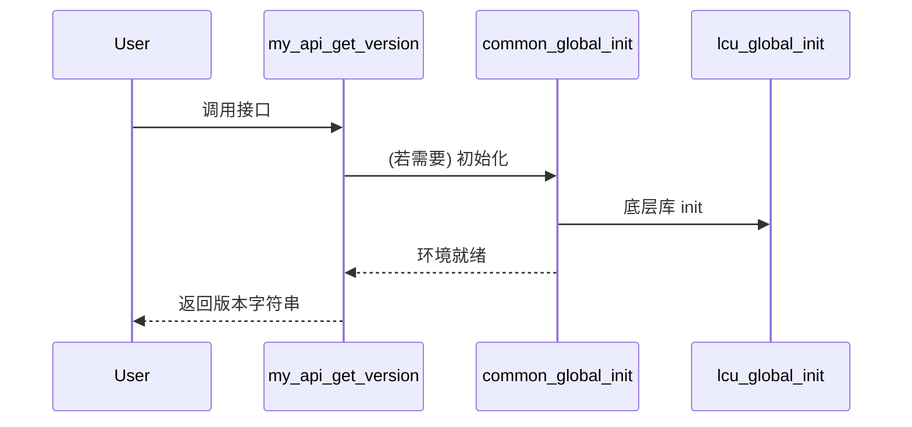

# 跨平台框架技术调研报告

> 项目：`my_prj`  （基于 C/C++11 + CMake 3.10+）  
> 调研日期：2025-10-17  
> 调研目标：梳理当前跨平台框架的架构、构建体系、平台抽象、关键技术与风险，并提出演进与落地建议，为后续技术决策提供依据。

---

## 1. 总览概述

该仓库实现了一个面向多平台（Windows / Linux / Android / 交叉 ARM 平台）的 C 语言主导、混合 C++ 的可裁剪框架。核心强调：

- 统一 CMake 构建 + 自定义宏封装 (`prj_cc_library`, `prj_cc_unit_test`) 简化模块声明。
- “All-In-One” 汇编选项（`PRJ_BUILD_ALL_IN_ONE`）可将子模块静态打包进单一导出库，便于分发。
- 灵活的平台 / ABI / STL / 交叉编译支持（工具链文件 + `platform_detector.cmake` 自动输出路径布局）。
- 通过 `common` 模块提供环境初始化、日志、JSON（自带裁剪版 cJSON）、调度/线程优先级、内存对齐与文件工具等基础设施。
- Android 侧提供 JNI 适配层，将 C API 包装给 Java 使用。

整体层次（由下至上）：

```text
[ third_party:lcu + 其他外部库 ]
              ↑
        [ common ]  —— 通用功能、封装自研 / 三方能力
              ↑
          [ api ]   —— 对外稳定 C 接口 (版本 + 语义封装)
              ↑           ↘ (Android) [ jni ]  —— Java 桥接
          [ example/tests ] —— 验证、示例、回归
              ↑
        [ all-in-one library (可选) ]
```

---

## 2. 构建与发布体系

### 2.1 CMake 结构

- 顶层 `CMakeLists.txt`：
  - 自动解析 `src/version.h` 生成 `project(my_prj VERSION ...)`。
  - 统一设置语言标准 C11 / C++11，支持可配置 PIC、ASan、隐藏符号、PCH。
  - `platform_detector.cmake` 负责：PLATFORM / PLATFORM_ABI 推导；输出产物目录规则：`tool/deploy/bin/<platform>_<abi>_<build_type>`。
  - 通过选项集成：
    - `PRJ_BUILD_ALL_IN_ONE`：聚合打包。
    - `PRJ_BUILD_SHARED` / `BUILD_SHARED_LIBS`：动态 / 静态策略。
    - `PRJ_HIDDEN_SYMBOLS`：非 Debug 默认隐藏，结合 version script / exports.def 控制导出面。
    - `PRJ_ENABLE_ASAN`：Debug 主工程默认开启（MSVC 版本限制下自动降级）。
    - `PRJ_TIDY`：可选 clang-tidy。
- `src/CMakeLists.txt`：组织子目录：`common`, `api`, `example`, `jni (Android)`。在 all-in-one 时建立主 target 并链接依赖。
- 自定义宏（推测定义于 `cmake/macros.cmake` 等）：封装 target 声明、依赖拷贝（资产/第三方库）。

### 2.2 交叉编译支持

- 通过 `cmake/toolchains/*.toolchain.cmake` 定义不同 SoC（如 `r328`, `rk3308`）工具链，设置编译器、sysroot、FIND_ROOT_PATH 策略。
- 构建脚本：
  - Linux/通用：`make_cross_platform.sh`（支持传递平台、ABI、BuildType、附加 CMake 选项）。
  - Android：`make_android.bat` 支持 ABI + STL (`c++_static` / `gnustl_static`) 组合输出。
  - Windows：`make_windows.bat` 自动或指派 VS 版本生成工程。（区分 Win32/Win64）。
- 输出路径编码平台/ABI/BuildType/（Android STL），便于多版本并存。

### 2.3 安装与发布

- 没有启用标准 `GNUInstallDirs`；安装逻辑主要以复制库/资源到 deploy 目录为主。
- 可扩展建议：后续若需要包管理（vcpkg / Conan）或系统级安装，可添加 `install(TARGETS ...)` + 导出 Config Package。

### 2.4 符号与可见性

- Windows：可选 `exports.def` 或 `__declspec(dllexport)` 宏控制。（`my_api.h` 中通过 ATTR_* 宏封装）。
- 非 Windows：利用 `__attribute__((visibility("default")))` 与 `-fvisibility=hidden` 策略，对外仅暴露 API 层函数，减小符号表与潜在冲突。

---

## 3. 模块分析

### 3.1 common 模块

职责：运行时初始化（环境变量、全局 init/cleanup）、文件读入（对齐内存）、路径处理、线程调度、JSON 解析（内嵌定制 my_cjson）、日志接口拼装。

关键点：

- `common_global_init()`：
  - 设置控制台 UTF-8（Windows），初始化第三方 `lcu`，写入 omp/kmp 环境变量。
  - 使用引用计数 `g_initialized_times` 防重复初始化 / cleanup。线程安全性尚未加锁（潜在改进）。
- `my_cjson.c`：内置 fork 自 cJSON 1.7.18，自定义前缀、内存钩子，全量实现（>3000 行）。
- `my_sched.*`：跨平台线程优先级、亲和性封装。Linux 使用 `setpriority`；Windows 使用 `OpenThread + SetThreadPriority`。
- `cjson_wrapper.h`：提供条件编译替换官方 cJSON 名称与若干抽取宏（`_CJSON_EXTRACT_*`）。
- 日志：`my_logger.h` 包装到 `example/include/log/logger.h`（最终由 `lcu` 提供日志 façade 选择 `slog`/`xlog`）。

### 3.2 api 模块

- 极简展示：只导出 `my_api_get_version()` 返回 `PRJ_VERSION` 常量字符串。
- `my_api_legacy.c` 预留向后兼容位置（可能存放旧 C 接口迁移层）。
- 通过 `ATTR_PUBLIC` 宏保证符号跨平台一致可见。

### 3.3 jni 模块（Android）

- `JNI_OnLoad`/`JNI_OnUnload` 中集中初始化/清理 `lcu` 与子模块。
- `jni_my_api.c` 将版本函数包装成 Java 调用：`Java_com_my_jni_MyApiJni_version`。
- 分层清晰：JNI 只做桥接，不直接耦合业务逻辑。

### 3.4 example 模块

- 作为测试驱动（以 `prj_cc_unit_test` 形式构建可执行），未直接依赖 all-in-one；可扩展为更系统的单元/集成测试目录。

### 3.5 第三方管理（`third_party/lcu`）

- `find_me.cmake` 用于注入 `lcu` 的 include/lib/asset 变量（未完全展开，但在 `common/CMakeLists.txt` 中示例读取 `${_LIB_NAME}-lib` 等）。
- 策略：不直接拉源码（对重编译最小化），要求外部提前构建好产物再放置。

---

## 4. 平台与抽象策略

| 关注维度 | 实现方式 | 评估 |
|----------|----------|------|
| 平台与 ABI 检测 | `platform_detector.cmake` + CMake 内置变量 + `ANDROID`/`WIN32` | 逻辑集中，可复用；建议补充更多架构判定（ARMv7 vs ARMv8 指令差异）|
| 工具链配置 | `toolchains/*.cmake` 手动编写 sysroot/前缀 | 灵活但需维护文档，建议加入自动探测或校验脚本 |
| 符号可见性 | 结合自定义选项 `PRJ_HIDDEN_SYMBOLS` | 规范，利于 SDK 发布；需补充 API 稳定性清单 |
| JSON 支持 | 内嵌裁剪 cJSON (my_cjson) | 减少外部依赖；需跟进上游安全修复(CVE) 与差异说明 |
| 日志 | 可切换 façade (slog/xlog) | 灵活；建议加入运行时级别控制与统一上下文字段 |
| 线程优先级/亲和 | 多平台封装 | 适合性能调优；需补充错误码统一及线程安全文档 |
| 初始化流程 | 引用计数（非线程安全） | 简洁；在多线程初始调用场景存在竞态风险 |

---

## 5. 数据/调用流示意

### 5.1 模块依赖关系 (Mermaid)

```mermaid
flowchart LR
  subgraph ThirdParty
    LCU[lcu library]
  end
  subgraph Common
    COMMON[common\n(init+json+sched+file)] --> LCU
  end
  API[api\n(version & legacy shim)] --> COMMON
  JNI[jni layer] --> API
  EXAMPLE[example/tests] --> API
  ALLINONE[(all-in-one lib)] --> API
```

### 5.2 构建流程 (简化)

```mermaid
graph TB
  A[Configure CMake]\n- Detect toolchain/platform
  B[Generate targets]\n(common/api/example/jni) 
  C{PRJ_BUILD_ALL_IN_ONE?}
  ### 3.1 common 模块

  职责：运行时初始化（环境变量、全局 init/cleanup）、文件读入（对齐内存）、路径处理、线程调度、JSON 解析（内嵌定制 my_cjson）、日志接口拼装。

  关键点：

  - `common_global_init()`：
    - 设置控制台 UTF-8（Windows），初始化第三方 `lcu`，写入 omp/kmp 环境变量。
    - 使用引用计数 `g_initialized_times` 防重复初始化 / cleanup。线程安全性尚未加锁（潜在改进）。
  - `my_cjson.c`：内置 fork 自 cJSON 1.7.18，自定义前缀、内存钩子，全量实现（>3000 行）。
  - `my_sched.*`：跨平台线程优先级、亲和性封装。Linux 使用 `setpriority`；Windows 使用 `OpenThread + SetThreadPriority`。
  - `cjson_wrapper.h`：提供条件编译替换官方 cJSON 名称与若干抽取宏（`_CJSON_EXTRACT_*`）。
  - 日志：`my_logger.h` 包装到 `example/include/log/logger.h`（最终由 `lcu` 提供日志 façade 选择 `slog`/`xlog`）。

  ### 3.2 api 模块

  - 极简展示：只导出 `my_api_get_version()` 返回 `PRJ_VERSION` 常量字符串。
  - `my_api_legacy.c` 预留向后兼容位置（可能存放旧 C 接口迁移层）。
  - 通过 `ATTR_PUBLIC` 宏保证符号跨平台一致可见。

  ### 3.3 jni 模块（Android）

  - `JNI_OnLoad`/`JNI_OnUnload` 中集中初始化/清理 `lcu` 与子模块。
  - `jni_my_api.c` 将版本函数包装成 Java 调用：`Java_com_my_jni_MyApiJni_version`。
  - 分层清晰：JNI 只做桥接，不直接耦合业务逻辑。

  ### 3.4 example 模块

  - 作为测试驱动（以 `prj_cc_unit_test` 形式构建可执行），未直接依赖 all-in-one；可扩展为更系统的单元/集成测试目录。

  ### 3.5 第三方管理（`third_party/lcu`）

  - `find_me.cmake` 用于注入 `lcu` 的 include/lib/asset 变量（未完全展开，但在 `common/CMakeLists.txt` 中示例读取 `${_LIB_NAME}-lib` 等）。
  - 策略：不直接拉源码（对重编译最小化），要求外部提前构建好产物再放置。

  ## 4. 平台与抽象策略

  | 关注维度 | 实现方式 | 评估 |
  |----------|----------|------|
  | 平台与 ABI 检测 | `platform_detector.cmake` + CMake 内置变量 + `ANDROID`/`WIN32` | 逻辑集中，可复用；建议补充更多架构判定（ARMv7 vs ARMv8 指令差异）|
  | 工具链配置 | `toolchains/*.cmake` 手动编写 sysroot/前缀 | 灵活但需维护文档，建议加入自动探测或校验脚本 |
  | 符号可见性 | 结合自定义选项 `PRJ_HIDDEN_SYMBOLS` | 规范，利于 SDK 发布；需补充 API 稳定性清单 |
  | JSON 支持 | 内嵌裁剪 cJSON (my_cjson) | 减少外部依赖；需跟进上游安全修复(CVE) 与差异说明 |
  | 日志 | 可切换 façade (slog/xlog) | 灵活；建议加入运行时级别控制与统一上下文字段 |
  | 线程优先级/亲和 | 多平台封装 | 适合性能调优；需补充错误码统一及线程安全文档 |
  | 初始化流程 | 引用计数（非线程安全） | 简洁；在多线程初始调用场景存在竞态风险 |

## 5. 数据/调用流示意

### 5.1 模块依赖关系 (Mermaid)

```mermaid
flowchart LR
  subgraph ThirdParty
    LCU[lcu library]
  end
  subgraph Common
    COMMON[common\n(init+json+sched+file)] --> LCU
  end
  API[api\n(version & legacy shim)] --> COMMON
  JNI[jni layer] --> API
  EXAMPLE[example/tests] --> API
  ALLINONE[(all-in-one lib)] --> API
```

### 5.2 构建流程 (简化)

```mermaid
graph TB
  A[Configure CMake]\n- Detect toolchain/platform
  B[Generate targets]\n(common/api/example/jni)
  C{PRJ_BUILD_ALL_IN_ONE?}
  D[Link sub-libs into single lib]
  E[Copy deps & assets to deploy/bin/*]
  A --> B --> C
  C -- Yes --> D --> E
  C -- No  --> E
```

### 5.3 运行初始化序列



### 8.7 性能调优入口

- 低成本可执行事项：
  1. 为 `common_aligned32_read_file` 添加 `mmap`（POSIX）与 `ReadFile`（Win32）分支以减少复制。
  2. 为 JSON 打开可选的 `-flto` 与 `-O3`（Release Profile）并记录基准。
  3. 在 `my_sched_set_thread_affinity` 失败时附加 `perror`/`strerror(errno)` 细节，便于场景复现。

---

## 9. 风险矩阵（Top 10）

| 序号 | 风险 | 影响 | 概率 | 综合 | 处置策略 |
|------|------|------|------|------|----------|
| R1 | my_cjson 未跟进安全补丁 | 安全/崩溃 | 中 | 高 | 建立上游版本追踪 + 安全扫描 (OSS Index) |
| R2 | 初始化非线程安全 | 随机崩溃/重复释放 | 中 | 高 | 引入原子/互斥；或在 API 层文档声明调用顺序 |
| R3 | 缺少系统化测试 | 回归不可控 | 高 | 高 | 引入 CI + 覆盖率统计 |
| R4 | 第三方依赖版本不可追踪 | 合规风险 | 中 | 中 | 添加 `THIRD_PARTY.md` + SBOM 生成 |
| R5 | 缺少错误码标准 | 调试低效 | 中 | 中 | 统一错误码框架 |
| R6 | 交叉编译工具链路径硬编码 | 构建不可移植 | 中 | 中 | 增加环境探测与 fallback 校验 |
| R7 | 日志上下文不足 | 线上诊断困难 | 中 | 中 | 结构化日志（时间/线程/模块/级别/trace id） |
| R8 | all-in-one 缺少成分清单 | 可追溯性差 | 低 | 中 | 生成编译元数据 JSON |
| R9 | 线程优先级跨平台差异未文档化 | 行为不确定 | 中 | 中 | 撰写平台差异文档与范围映射 |
| R10 | 缺少 License 复核流程 | 合规泄漏 | 低 | 中 | 脚本扫描依赖 License 类型 |

---

## 10. 演进路线图（建议分三阶段）

### 阶段 1（1~2 周）

- [ ] 引入 CI (GitHub Actions) 矩阵：Win / Ubuntu / Android NDK (armeabi-v7a, arm64-v8a)。
- [ ] 新建 `tests/` 目录，补充 API / JSON 解析核心单测；打开 `PRJ_BUILD_TESTS` 默认 ON（CI 环境）。
- [ ] 修复 common init 线程安全（原子 + CAS）。
- [ ] 建立 `THIRD_PARTY.md` + 自动生成版本清单脚本。

### 阶段 2（3~4 周）

- [ ] 引入统一错误码与 `prj_last_error()` 接口。
- [ ] 结构化日志接口 + 运行时日志级别动态调整。
- [ ] JSON 模块 fuzz harness（libFuzzer/afl++）。
- [ ] 生成构建元数据（写入 `<deploy>/bin/.../buildinfo.json`）。

### 阶段 3（>1 月）

- [ ] 可选引入 yyjson 形成双栈（策略模式选择）。
- [ ] Emscripten/WebAssembly 试验性支持。
- [ ] 线程/CPU 亲和策略抽象升级（NUMA / big.LITTLE）。
- [ ] 发布 CMake Package + vcpkg port（提升生态集成）。

---

## 11. 采用建议（决策支撑）

| 决策议题 | 采用策略 | 预期收益 | 复杂度 | 说明 |
|----------|----------|----------|--------|------|
| 构建体系 | 保持 CMake + 自定义宏，补充安装导出 | 提升集成与分发 | 中 | 兼容现有脚本，无大规模迁移 |
| JSON 引擎 | 默认 my_cjson + 可选 yyjson 插件化 | 性能弹性 + 安全追踪 | 中 | 以 wrapper 接口适配 |
| 日志系统 | 引入结构化字段 + 动态级别 | 运维可观测性 | 低 | 保留 slog/xlog 选择 |
| 错误码框架 | 枚举 + TLS + strerror | 调试效率提升 | 低 | 与现有 int 返回兼容（过渡层） |
| 测试体系 | CTest + 覆盖率 + fuzz | 质量基线可量化 | 中 | 需 CI 支撑 |
| 安全合规 | SBOM + License scan | 降低供应链风险 | 中 | 自动化脚本一次搭建后维护低 |
| All-in-one | 保持可选 + 元数据嵌入 | 发行清晰 | 低 | 增加可观测性与可追踪性 |

---

## 12. 附录

### 12.1 关键宏与选项速查

```
PRJ_BUILD_ALL_IN_ONE   打包聚合主库
PRJ_BUILD_SHARED       构建动态库
PRJ_ENABLE_ASAN        Debug 内存检测
PRJ_HIDDEN_SYMBOLS     Release 默认隐藏内部符号
PRJ_TIDY               启用 clang-tidy
PRJ_BUILD_TESTS        构建测试
CMAKE_WINDOWS_EXPORT_ALL_SYMBOLS Windows 自动导出全部符号（备用）
```

### 12.2 目录速览（精选）

```
src/
  common/        基础设施 & 工具集合
  api/           对外接口
  jni/           Android 桥接
  example/       示例 & 测试
  third_party/   预编译第三方
cmake/toolchains/ 交叉编译工具链文件
```

### 12.3 后续补充潜力

- 增加 `docs/architecture_diagram.drawio` 或 PlantUML 版本，便于持续演化。
- 输出二进制尺寸基线表（按目标/配置统计）。
- 引入 clang-format + pre-commit 统一风格。

---
**结论摘要**：当前框架在跨平台可移植性、构建组织、基础设施抽象上已经具备良好扩展形态；主要短板集中在（测试 + 安全追踪 + 工具链自动化 + 线程安全细节）。按本报告路线图执行后，可在 1~2 个版本周期内达到“可发布 SDK / 易于生态集成 / 可运维观测”的成熟度等级。

> 如需我进一步输出 CI 配置示例、错误码框架雏形或 JSON 双栈封装骨架，请直接提出。 😊
